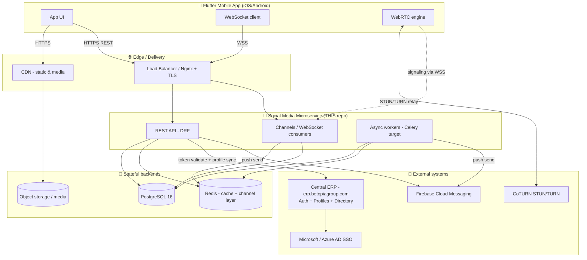
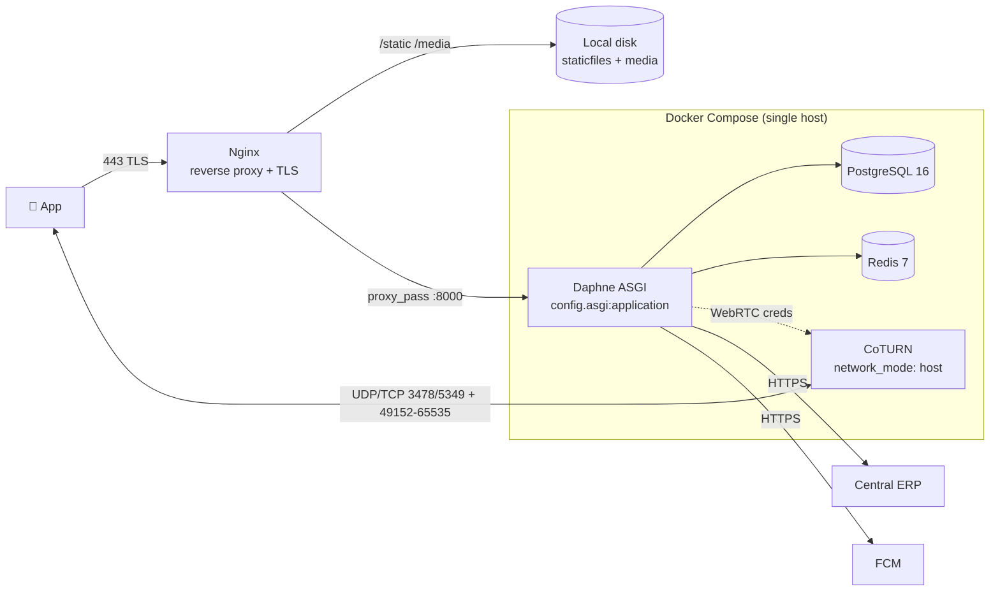
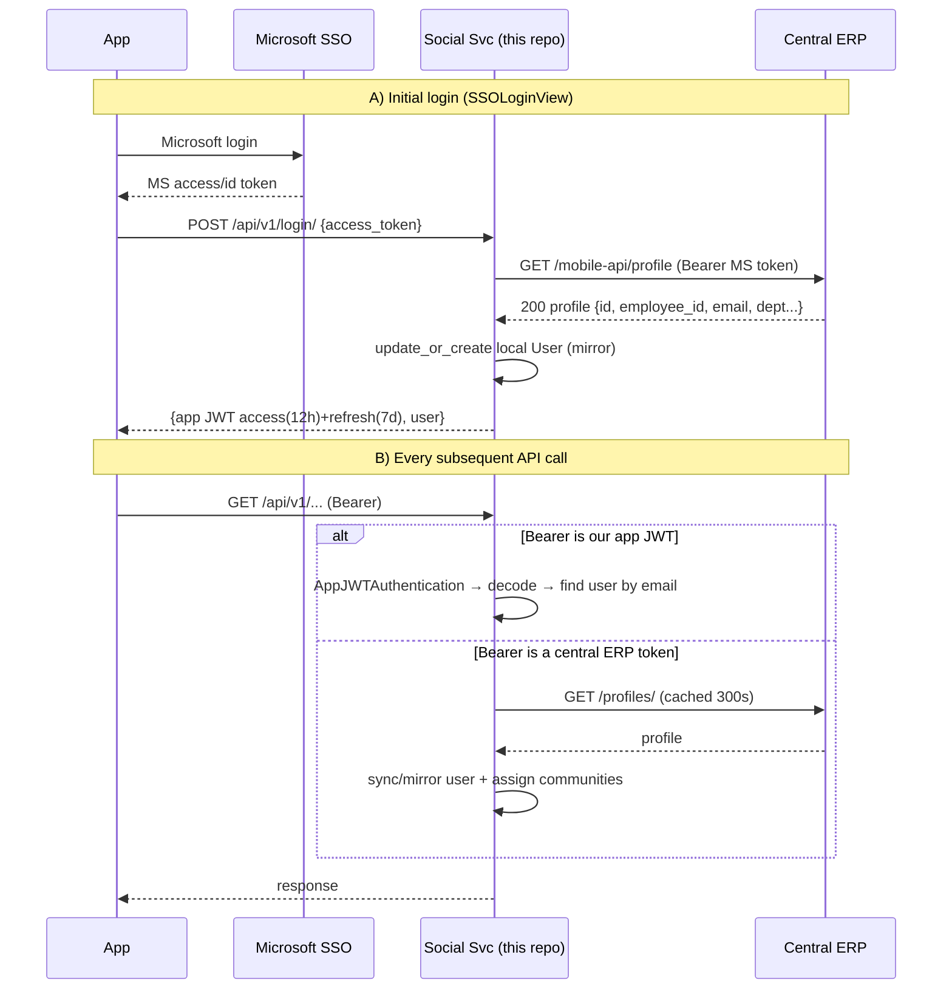
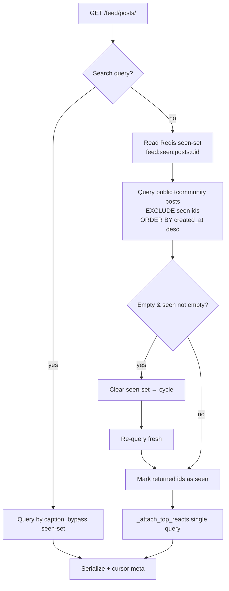
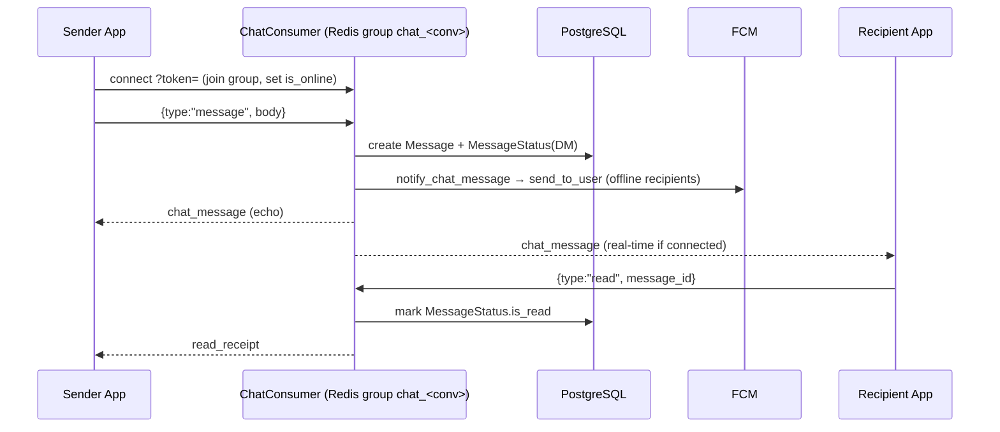
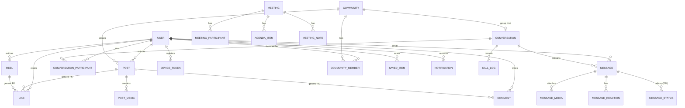
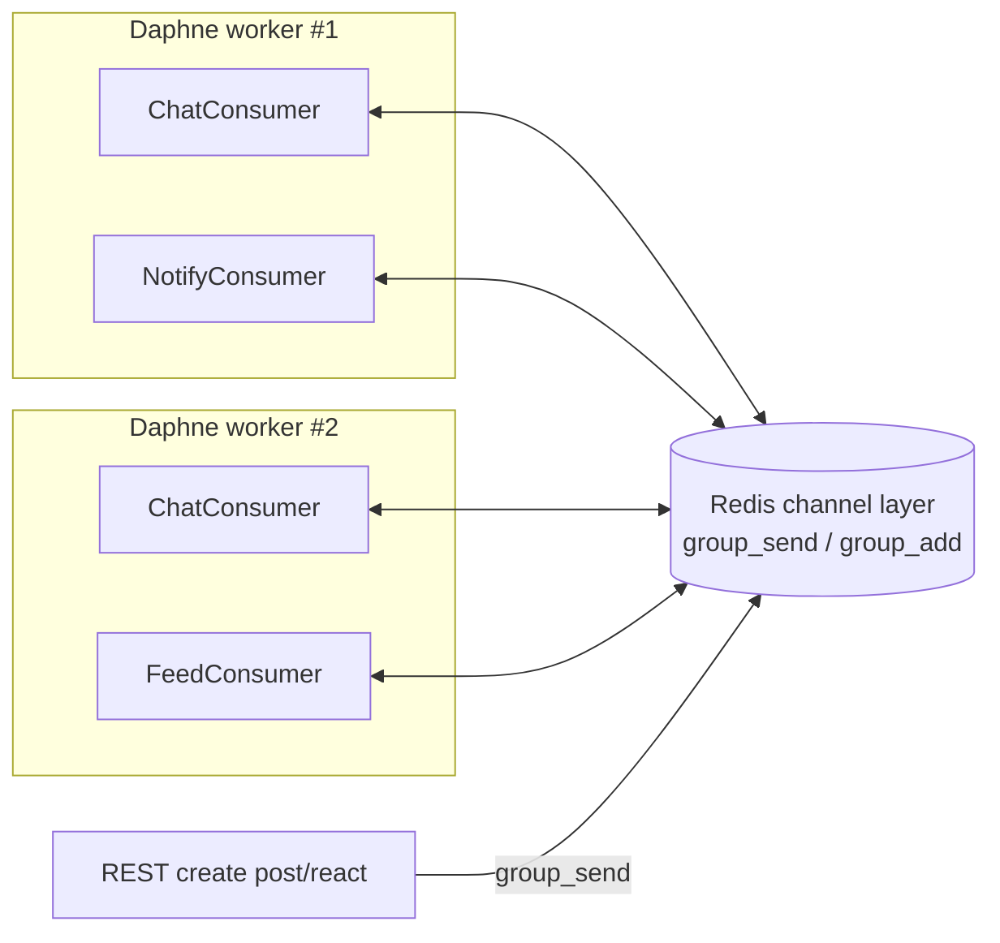
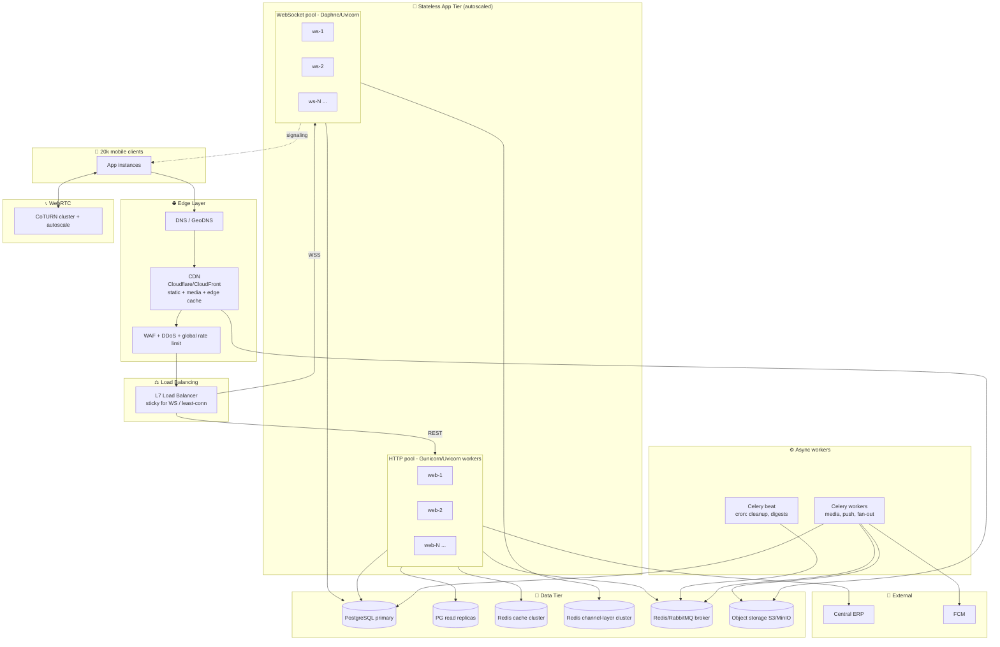

# Betopian Social Media Microservice — High Level System Design (HLD)

> **Service name:** `betopian-erp-microservice` (a.k.a. `betopian-server`)
> **Public domain:** `social-media.betopiagroup.com`
> **Role:** The **Social + Communication microservice** of the larger Betopia ERP platform.
> **Client:** A Flutter mobile app (iOS + Android).
> **Target scale for this document:** ~**20,000 employees / users**, with a realistic online concurrency of **2,000–4,000** and peak WebSocket concurrency of **~5,000+**.
> **Stack:** Django 5.2 (ASGI) · Django REST Framework · Django Channels (WebSockets) · Daphne · PostgreSQL 16 · Redis 7 · CoTURN (WebRTC) · Firebase Cloud Messaging (FCM) · Docker Compose · Nginx.

This document describes the system **as it exists today**, and then lays out the **production-grade target architecture** required to reliably serve 20k users — CDN, load balancing, threading/worker model, throttling, horizontal scaling, caching, background jobs, observability, and failure handling.

---

## Table of Contents

0. [Combined System Design (single unified view)](#0-combined-system-design)
1. [System Context — where this microservice sits](#1-system-context)
2. [Current Architecture (as-built)](#2-current-architecture-as-built)
3. [Authentication & Identity Model](#3-authentication--identity-model)
4. [Module-by-Module Deep Dive](#4-module-by-module-deep-dive)
   - 4.1 Authentication (SSO mirror)
   - 4.2 Contents (Posts, Reels, Media, Communities, Saved)
   - 4.3 Feed (News feed, Reel feed, Community feed)
   - 4.4 Interactions (Reactions, Comments)
   - 4.5 Chat / Messaging (DM + Group, real-time)
   - 4.6 Calling (WebRTC audio/video signaling)
   - 4.7 Notifications (in-app real-time + push)
   - 4.8 MoM (Meetings & Notes)
   - 4.9 Ebook (Content library)
   - 4.10 Utils (Media, FCM, throttles, middleware)
5. [Data Model Overview](#5-data-model-overview)
6. [Real-Time Layer (Channels/Redis) design](#6-real-time-layer)
7. [Production Target Architecture for 20k Users](#7-production-target-architecture-for-20k-users)
   - CDN · Load Balancing · Worker/Threading model · Autoscaling
   - Throttling & Rate limiting · Caching strategy · Background jobs
   - Database scaling · Media/object storage · WebRTC scaling
8. [Cross-Cutting Concerns](#8-cross-cutting-concerns)
   - Security · Observability · Reliability · Cost
9. [Known Gaps & Hardening Backlog](#9-known-gaps--hardening-backlog)
10. [Capacity Planning (rough numbers)](#10-capacity-planning)

---

## 0. Combined System Design

This is the **one-page, everything-in-one-view** design. It fuses the **production target topology** (edge → load balancing → autoscaled app tier → data tier) with the **internal module map** (every feature module and where its data lands) and the **external integrations**. Read this first for the whole picture; the later sections zoom into each part.

```mermaid
flowchart TB
    %% ================= CLIENTS =================
    subgraph CLIENTS["📱 Clients — ~20k Flutter apps (iOS / Android)"]
        REST_C[REST calls]
        WS_C[WebSocket client]
        RTC_C[WebRTC engine]
        FCM_C[FCM receiver]
    end

    %% ================= EDGE =================
    subgraph EDGE["🌐 Edge & Delivery"]
        DNS[GeoDNS]
        CDN[CDN cache<br/>static + media/HLS]
        WAF[WAF + DDoS + global rate-limit]
        LB[L7 Load Balancer + TLS<br/>separate HTTP & WS target groups]
    end

    %% ================= APP TIER =================
    subgraph APP["🧩 Stateless App Tier (autoscaled pods)"]
        direction TB
        subgraph HTTP["HTTP pool — Gunicorn + gthreads"]
            direction TB
            AUTH[Auth<br/>SSO mirror, JWT]
            CONTENT[Contents<br/>posts / reels / media / communities / saved]
            FEEDM[Feed<br/>news / reel / community + seen-sets]
            INTER[Interactions<br/>reactions / comments]
            CHATV[Chat REST<br/>history, media upload, search, TURN creds]
            NOTIFV[Notifications REST<br/>list, badge, device tokens]
            MOM[MoM<br/>meetings / notes]
            EBOOK[Ebook library]
        end
        subgraph WS["WebSocket pool — Daphne/Uvicorn"]
            direction TB
            CHATC[ChatConsumer<br/>chat_&lt;conv&gt;: msg/typing/presence/react]
            CALLC[Call signaling<br/>invite/offer/answer/ICE relay]
            FEEDC[FeedConsumer<br/>new-content pings]
            NOTIFC[NotificationConsumer<br/>notify_&lt;user&gt;]
        end
    end

    %% ================= ASYNC =================
    subgraph ASYNC["⚙️ Async Workers (Celery)"]
        PUSHW[Push fan-out → FCM]
        MEDIAW[Image compress / video → HLS]
        FANOUT[Feed & notification fan-out]
        BEAT[Beat: token cleanup, seen-set/notif prune, digests]
    end

    %% ================= DATA =================
    subgraph DATA["💾 Data Tier"]
        PGP[(PostgreSQL primary)]
        PGR[(Read replicas)]
        PGB[PgBouncer pooler]
        RDCACHE[(Redis — cache<br/>auth 300s, feed cache, seen-sets, throttles)]
        RDCHAN[(Redis — channel layer<br/>group_send / presence)]
        BROKER[(Redis/RabbitMQ — Celery broker)]
        OBJ[(Object storage S3/MinIO<br/>media, avatars, ebooks, HLS)]
    end

    %% ================= RTC & EXTERNAL =================
    subgraph RTC["📞 WebRTC media"]
        TURN[CoTURN cluster<br/>STUN/TURN relay + HMAC creds]
    end
    subgraph EXT["🏢 External systems"]
        ERP[Central ERP<br/>SSO validate + profiles + directory]
        MSSO[Microsoft / Azure AD]
        FCM[Firebase Cloud Messaging]
    end

    %% ================= EDGES =================
    REST_C --> DNS --> CDN --> WAF --> LB
    WS_C -->|WSS| WAF
    CDN --> OBJ
    LB -->|REST| HTTP
    LB -->|WSS| WS

    %% app -> data
    HTTP --> PGB --> PGP
    HTTP -->|reads| PGR
    HTTP --> RDCACHE
    HTTP --> BROKER
    HTTP --> OBJ
    WS --> RDCHAN
    WS --> PGB

    %% cross-module real-time triggers
    CONTENT -.new post/reel.-> RDCHAN
    INTER -.reaction.-> RDCHAN
    RDCHAN --> FEEDC
    RDCHAN --> NOTIFC
    RDCHAN --> CHATC
    RDCHAN --> CALLC

    %% async
    HTTP -. enqueue .-> BROKER
    WS -. enqueue .-> BROKER
    BROKER --> ASYNC
    ASYNC --> PGP
    ASYNC --> OBJ
    PUSHW --> FCM
    BEAT --> BROKER

    %% external
    AUTH -->|validate token<br/>+ mirror profile| ERP
    CHATV -->|employee search| ERP
    ERP --> MSSO
    FCM --> FCM_C
    RTC_C <-->|media P2P / relay| TURN
    CALLC -.signaling.-> WS_C
    HTTP -->|TURN HMAC creds| RTC_C
```



### How to read this diagram

- **Vertical flow = request path:** client → GeoDNS → CDN → WAF → load balancer → app pool. Media bytes never touch the app — they come straight from **CDN + object storage**.
- **Two app pools, one codebase:** the same Django project runs as an **HTTP pool** (DRF views, Gunicorn) and a **WebSocket pool** (Channels consumers, Daphne). They are deployed and scaled independently but share Postgres/Redis.
- **Redis has three distinct roles** (cache, channel layer, Celery broker) — shown as separate stores because at 20k users they should be separate instances/clusters.
- **The dotted "real-time trigger" arrows** show the key cross-module pattern: a write in **Contents** or **Interactions** does a `group_send` into the **Redis channel layer**, which fans out to the **Feed / Notification / Chat consumers** connected to any WS pod. This is what makes the real-time layer horizontally scalable.
- **Async offload:** anything slow or bursty (FCM fan-out, image/video processing, large-audience notifications) is enqueued to the **Celery broker** and handled off the request path.
- **External boundary:** identity + directory live in **Central ERP** (which itself brokers **Microsoft SSO**); push goes out via **FCM**; call media traverses the **CoTURN** cluster.

### One-line data-ownership map

| Layer | Owns / stores | Backed by |
|---|---|---|
| **Central ERP (external)** | Identity, SSO, employee directory | — |
| **Auth module** | Read-only **user mirror**, app JWTs | Postgres + Redis (profile cache) |
| **Contents / Feed / Interactions** | Posts, reels, media, communities, reactions, comments, saved, seen-state | Postgres + Redis + Object storage |
| **Chat / Calling** | Conversations, messages, media, reactions, statuses, call logs | Postgres + Redis (channel layer) + CoTURN |
| **Notifications** | In-app notifications, badge state, device tokens | Postgres + Redis + FCM |
| **MoM / Ebook** | Meetings, agenda, notes, ebook library | Postgres + Object storage |

---

## 1. System Context

This service is **one microservice inside a larger ERP**. It **does not own identity**. The **Central ERP** (`erp.betopiagroup.com`) is the source of truth for employees, authentication (Microsoft SSO / Azure AD), and the employee directory. This service keeps a **read-only mirror** of user data and owns all *social* data (posts, reels, chats, calls, reactions, comments, notifications, meetings-notes, ebooks).



**Key context facts pulled from the code:**

- Login flow: the mobile app authenticates with **Microsoft**, gets an MS token, and posts it to `/api/v1/login/`. This service **forwards it to Central ERP** (`/mobile-api/profile`) to validate + fetch the profile, then issues **its own JWT** (SimpleJWT, 12h access / 7d refresh). See `apps/authentication/`.
- Every authenticated request can also carry the **central bearer token**; `CentralTokenAuthentication` transparently validates it against `erp.betopiagroup.com/profiles/` and **lazily mirrors** the user into the local `users` table (cached 300s).
- Real-time (chat, feed pings, notifications, call signaling) is delivered over **Django Channels + Redis channel layer**, served by **Daphne (ASGI)**.
- WebRTC calls use **CoTURN**; the app fetches short-lived HMAC TURN credentials from `/api/v1/turn-credentials/`.
- Push notifications go through **Firebase Cloud Messaging** using device tokens registered per user.

---

## 2. Current Architecture (as-built)

Today the entire service runs as a **single Docker Compose stack on one VPS**, fronted by Nginx.



**As-built characteristics (from `docker-compose.yml`, `Dockerfile`, `config/settings.py`):**

| Concern | Current state | Notes |
|---|---|---|
| App server | **Daphne** single process, ASGI | `daphne -b 0.0.0.0 -p 8000 config.asgi:application` |
| HTTP + WS | Same process serves **both** | `ProtocolTypeRouter` in `config/asgi.py` |
| DB | PostgreSQL 16 (single container) | Was SQLite in dev; PG in Docker |
| Cache + channel layer | Redis 7 (single container, DB 0 = channels, DB 1 = cache) | `channels_redis` + `django_redis` |
| Media/static | **Local disk volumes** + WhiteNoise for static | Not durable/scalable |
| Push | Firebase Admin SDK | Lazy-initialized singleton |
| WebRTC | CoTURN with static HMAC secret | `network_mode: host` |
| TLS | Nginx + Certbot (Let's Encrypt) | Manual renew hook |
| Config | `python-decouple` `.env` | `DEBUG=True` currently ⚠️ |
| Error tracking | **Sentry** SDK initialized | DSN hardcoded in settings ⚠️ |
| Gunicorn settings | Present in settings but **unused** (Daphne is the runtime) | `GUNICORN_*` defined for future WSGI workers |

> **This single-node setup is fine for a pilot, but it is a single point of failure and cannot safely reach 20k users.** Section 7 defines the target.

---

## 3. Authentication & Identity Model

Identity is **federated**. This service never stores passwords for real users (only for local Django admins). Two DRF authenticators run in order (`config/settings.py → REST_FRAMEWORK`):



**Design highlights & rationale:**

- **`AppJWTAuthentication`** (`apps/authentication/backends.py`): validates our own SimpleJWT and resolves the local user by email. Fast path, no network.
- **`CentralTokenAuthentication`**: accepts a raw central ERP token, validates it against Central ERP, and **mirrors the user** into `users` on the fly. **Profile responses are cached in Redis for 300s** keyed by `sha256(token)` to avoid hammering the ERP on every request. A `user_pk` cache is also kept per `employee_id`.
- **Resilience:** during login, if Central ERP is *down* (not 401), a **known user is still let through** using stored data — a deliberate graceful-degradation choice.
- **WebSocket auth** (`apps/chat/middleware.py`): the JWT is passed as a **query-string param** (`?token=`) because browsers/mobile WS clients can't set Authorization headers easily. The middleware decodes `uid` and looks up the user by `central_id`.
- **Community auto-assignment** (`apps/contents/community.py`): on each sync, the user is matched to `Community` rows by keyword against their `address/company/department`, re-evaluated every 7 days, and auto-joined to the matching community group chat.

> ⚠️ **Security note:** WS middleware and MS-claim decoding use `verify_signature=False`. The app JWT relies on the query token being a valid SimpleJWT, but the WS middleware does **not** verify the signature — see [Gaps](#9-known-gaps--hardening-backlog).

---

## 4. Module-by-Module Deep Dive

All REST endpoints are mounted under `/api/v1/` (`apps/apis/urls.py`). WebSockets are mounted under `/ws/...` (`config/asgi.py`). Every model inherits `TimeStampedModel` (UUID PK + `created_at`/`updated_at`) and tables use explicit indexes.

### 4.1 Authentication (`apps/authentication`)

- **Endpoints:** `POST /login/`, `POST /logout/`, `GET /profile/`.
- **Model:** `User` — UUID PK, `central_id`, `employee_id`, `email`, profile fields, `is_online`, `last_seen`, `central_access_token` (kept fresh for downstream ERP calls), `community_assigned_at`.
- **Throttle:** `AuthThrottle` (`auth` scope, default `10/min`) to blunt brute force.
- **Notable:** logout is a no-op server-side (stateless JWT) — token invalidation is client-driven; blacklisting app exists (`token_blacklist`) but refresh-rotation isn't wired.

### 4.2 Contents (`apps/contents`)

Owns the **content graph**: `Post`, `PostMedia` (image/video, per-item captions, view counts), `Reel` (single video), `ReelView` (per-user capped view counter), `Community`, `CommunityMember`, `SavedItem`.

- **Endpoints:** posts CRUD, reels CRUD, `reels/<id>/view/`, communities list + members, `save/<type>/<id>`, `saved/`.
- **Privacy:** `public` / `only_me`. Communities scope posts to members.
- **Media handling:** images are **compressed with Pillow** on upload (`apps/utils/media.py`) — resized to ≤1920px, re-encoded JPEG q85. Videos are stored as-is (size-limited).
- **Performance patterns:** heavy use of `select_related`/`prefetch_related`, `Count(distinct=True)` annotations, `Exists()` for `is_saved`, and a **single-query `_attach_top_reacts`** helper to avoid N+1 on reaction previews.
- **Fan-out on create:** `PostListCreateView.post` → `notify_post_created` (feed WS ping) + feed cache invalidation.
- **Throttle:** `UploadThrottle` (`upload` scope, `30/min`).

### 4.3 Feed (`apps/feed`)

Three feeds, all **cursor-paginated** (opaque base64 `created_at__id` cursors — no expensive `OFFSET`):

1. **News feed** `GET /feed/posts/` — public posts + community posts the user belongs to.
2. **Reel feed** `GET /feed/reels/` — **unified** stream of direct `Reel`s **and** post videos (`PostMedia` of type video), merged and sorted by recency.
3. **Community feed** `GET /feed/community/<id>/` — members-only, **Redis-cached** per user/community/page (60s first page, 120s deeper pages).

**"Seen-set" personalization (Redis Sets):** For posts and reels, each user has a Redis set `feed:seen:<type>:<user_id>` (TTL 7 days). Each page **excludes already-seen items**; when the pool is exhausted the set is cleared and the feed **cycles**. This gives an infinite-scroll "you won't see the same thing twice (until you've seen everything)" experience without a recommender.



- **Real-time freshness:** `FeedConsumer` (`/ws/feed/`) lets clients `subscribe` to `feed_posts`, `feed_reels`, or `feed_community_<id>`. On new content, `apps/feed/notify.py` broadcasts a lightweight *"New post, please refresh"* ping (excluding the author). The client then re-pulls the REST feed — a **push-to-invalidate, pull-to-fetch** pattern that keeps payloads tiny.
- **Throttle:** `FeedThrottle` (`feed` scope, `120/min`).

### 4.4 Interactions (`apps/interactions`)

Generic (via `ContentType`) reactions and comments that attach to **posts, post-media, or reels**.

- **`Like`** = a unified **reaction** (love/angry/haha/wow/sad/care), **one row per user per target**; re-reacting switches, same reaction toggles off. Indexed on `(content_type, object_id)` and `(…, reaction)`.
- **`Comment`** = threaded (self-FK `parent`), soft-deletable, returned as an **O(n) in-memory tree** with cursor pagination on roots.
- **Endpoints:** `react/<type>/<id>`, `reactors/<type>/<id>` (paged + per-reaction breakdown), `comment/...` CRUD.
- **Side effects:** a reaction triggers `notify_reaction` (real-time notification to the content owner, deduped/aggregated "X and N others").
- **Throttle:** `InteractionThrottle` (`interactions` scope, `60/min`).

### 4.5 Chat / Messaging (`apps/chat`)

Full real-time messaging for **DMs** (2 participants) and **Group** chats (bound 1:1 to a `Community`).

**Models:** `Conversation`, `ConversationParticipant`, `Message` (text/media/doc/deleted/call, reply-to, edit/delete flags), `MessageMedia`, `MessageReaction`, `MessageStatus` (per-recipient delivered/read — **DM only**, to avoid row explosion in big groups), `CallLog`.

**Transport split (deliberate):**
- **Text / edit / delete / react / typing / read / presence** → **WebSocket** (`ChatConsumer`, `/ws/chat/<conv_id>/`).
- **Media/doc upload** → **HTTP** `POST /conversations/<id>/messages/` (multipart, image compression), then the client emits a `media_sent` WS event so peers get the message in real time.



- **Presence:** on connect/disconnect the consumer flips `User.is_online` and broadcasts presence to the room.
- **Pagination:** message history and conversation list are cursor-paginated with unread-count subqueries; latest page auto-marks read.
- **Search:** `GET /conversations/user/search/` queries the **Central ERP employee directory** (cached 30s) and flags who is already active on social.
- **Push bridge:** every new chat message calls `notify_chat_message` → FCM to all other participants (title = sender/community, body = preview).

### 4.6 Calling — WebRTC signaling (`apps/chat/consumers.py` + CoTURN)

1:1 audio/video calling. **The Django server is a pure signaling relay** — it never touches media. Media flows peer-to-peer (or via TURN relay when NAT blocks P2P).

```mermaid
sequenceDiagram
    participant A as Caller
    participant TURNAPI as /api/v1/turn-credentials/
    participant WS as ChatConsumer (signaling)
    participant B as Callee
    participant TURN as CoTURN

    A->>TURNAPI: GET (HMAC creds, 24h TTL)
    TURNAPI-->>A: ice_servers [stun, turn(user,cred)]
    A->>WS: call_invite {call_type}
    WS-->>B: call_invite (ring)
    B->>WS: call_accept
    WS-->>A: call_accept
    A->>WS: offer (SDP)  --> WS -->> B
    B->>WS: answer (SDP) --> WS -->> A
    A->>WS: ice_candidate --> WS -->> B (and reverse)
    A<-->B: 🔊 Media (P2P or via TURN relay)
    A->>WS: call_end {duration}
    WS->>WS: _save_call_log (Message type=call + CallLog)
```

- **Signaling events:** `call_invite / accept / decline / missed / end` + WebRTC `offer / answer / ice_candidate`, all relayed through the same `chat_<conv_id>` Redis group.
- **Call records:** a completed/missed/declined call is persisted as a `Message(type=call)` + `CallLog` (with duration), so it appears inline in the chat thread.
- **TURN credentials:** time-limited **HMAC-SHA1** (`username = expiry:user_id`, `credential = base64(hmac(secret, username))`) — the CoTURN REST-auth pattern. Secret shared via `TURN_SECRET`.

### 4.7 Notifications (`apps/notifications`)

Two delivery rails from a single API:

- **In-app real-time:** `NotificationConsumer` (`/ws/notifications/`) — each user joins their own group `notify_<user_id>`; `notify.py::deliver()` pushes a typed envelope.
- **Push (background/offline):** `DeviceToken` model stores per-device FCM tokens; `apps/utils/fcm.py::send_to_user` does a multicast send and **auto-prunes dead tokens**.
- **Models:** `Notification` (event + JSON payload + read flag), `NotificationState` (last-seen timestamp → drives the unread **badge count**), `DeviceToken`.
- **Endpoints:** list, unread-count, read-all, mark-read, delete, `devices/unregister` (device registration at login).

### 4.8 MoM — Minutes of Meetings (`apps/mom`)

A **notes & meetings** module keyed by **`central_id`** (not the local UUID user) — i.e. it's designed to interoperate directly with Central ERP identities.

- **Models:** `Meeting`, `MeetingParticipant` (caches directory profile fields locally to avoid per-request ERP calls; supports **bulk parallel profile fetch** via `ThreadPoolExecutor` in `backends.py`), `MeetingPin`, `AgendaItem`, `MeetingNote`, `GeneralNote`.
- **Endpoints:** general notes CRUD + pin, meetings CRUD + pin, participants add/remove, agenda items, meeting notes, and a combined `notes-tab/`.

### 4.9 Ebook (`apps/ebook`)

A simple content library: `EbookTitle` (category) → `Ebook` (PDF file). Read endpoints `ebook-titles/`, `ebooks/`. Managed through admin.

### 4.10 Utils (`apps/utils`)

Shared plumbing: `APIResponse` (uniform success/error envelope), `TimeStampedModel`, `compress_image`, `validate_file_size`, FCM helper, **named throttle classes**, `DisableCSRFForAPI` middleware (JWT APIs skip CSRF), profile-image upload/store.

---

## 5. Data Model Overview



**Modeling notes:**
- **Generic relations** (`ContentType` + UUID `object_id`) let `Like`/`Comment`/`SavedItem`/`ReelView` attach to `Post`, `PostMedia`, or `Reel` uniformly.
- **UUID PKs everywhere** — good for sharding/merging and for not leaking counts, at a small index-size cost.
- Every hot query path has a **matching composite index** (e.g. `idx_msg_conv_created`, `idx_post_created`, `idx_like_target`, `idx_conv_activity`).

---

## 6. Real-Time Layer

All three WebSocket surfaces share one Redis channel layer:

| Consumer | Route | Redis groups | Purpose |
|---|---|---|---|
| `ChatConsumer` | `/ws/chat/<conv_id>/` | `chat_<conv_id>` | messages, typing, presence, reactions, **call signaling** |
| `FeedConsumer` | `/ws/feed/` | `feed_posts`, `feed_reels`, `feed_community_<id>` | "new content" pings |
| `NotificationConsumer` | `/ws/notifications/` | `notify_<user_id>` | real-time alerts + badge |



Because groups live in **Redis**, any Daphne instance can broadcast to any connected client on any other instance — this is what makes horizontal scaling of the WS tier possible (Section 7).

---

## 7. Production Target Architecture for 20k Users

The single-node stack must evolve into a **horizontally scalable, no-single-point-of-failure** deployment. Below is the target.



### 7.1 CDN (Content Delivery Network)

- **Why:** posts/reels are **media-heavy** (images ≤10MB, videos ≤200MB). Serving these from the Django host or one Nginx box will saturate bandwidth long before 20k users.
- **Target:** move all `MEDIA_ROOT`/`STATIC_ROOT` to **object storage (S3/MinIO/GCS)** and front it with a **CDN (Cloudflare / CloudFront)**.
  - Django serves only **signed URLs / metadata**; bytes are served from the edge.
  - Use `django-storages` so `PostMedia.file`, `Reel.video`, `MessageMedia.file`, avatars, ebooks all write to the bucket.
  - Static assets already use **WhiteNoise** — keep it, but let the CDN cache `/static/` with long TTL + hashed filenames.
- **Video:** ideally transcode to HLS/DASH (adaptive bitrate) in a Celery job so reels stream smoothly on mobile networks; CDN caches the segments.
- **Cache policy:** immutable media (hashed keys) → `Cache-Control: public, max-age=31536000, immutable`. Signed URLs for `only_me`/private content with short expiry.

### 7.2 Load Balancing

- **L7 load balancer** (ALB / Nginx / HAProxy / Cloudflare LB) in front of the app tier with:
  - **HTTP pool** and **WebSocket pool as separate target groups** (different scaling + timeout profiles).
  - **WS needs sticky sessions or long idle timeouts** (e.g. 1h+) and connection draining on deploy; HTTP can be least-connections/round-robin.
  - **Health checks** hitting a lightweight `/healthz` (add one) — not `/` (admin) or DB-heavy paths.
- **TLS termination** at the LB/CDN; internal traffic on private network.
- **Split the ASGI runtime:** run **HTTP via Gunicorn + Uvicorn workers** (or keep Daphne) and **WebSockets via a dedicated Daphne/Uvicorn fleet**. This isolates a WS connection storm from HTTP request latency.

### 7.3 Threading / Worker / Concurrency Model

This is the most important tuning area because the app mixes **sync DB work** and **async WS I/O**.

- **HTTP tier (WSGI-style sync views):** DRF views are synchronous and DB-bound. Use **Gunicorn** with:
  - `workers = 2 × vCPU + 1` (the codebase already exposes `GUNICORN_WORKERS`, `GUNICORN_THREADS`, `GUNICORN_TIMEOUT=120`, `GUNICORN_KEEPALIVE=5`).
  - `gthread` worker class with a modest thread count (e.g. 4) so blocking calls to **Central ERP** don't pin a whole worker. Note: `CentralTokenAuthentication` and search do **synchronous `requests.get`** to the ERP — these must have tight timeouts (they do: 10–20s) and ideally move behind the 300s cache + a circuit breaker.
  - Set **DB `CONN_MAX_AGE`** (persistent connections) and put **PgBouncer** in front of Postgres so N workers don't exhaust connections.
- **WebSocket tier (async consumers):** Daphne/Uvicorn is single-threaded async per process → run **one process per core**, many cores. Each `database_sync_to_async` call hops to a threadpool; keep those DB ops short (they are). Scale by **adding processes/pods**, not threads.
- **Offload blocking work to Celery** (below) so neither tier blocks on FCM sends, image compression of large batches, video transcoding, or ERP bulk fetches.

### 7.4 Autoscaling / Horizontal Scaling

- **Stateless app tier** → containerize (already Dockerized) and run on **Kubernetes / ECS / Nomad** with **HPA**:
  - HTTP pods scale on **CPU + request latency + RPS**.
  - WS pods scale on **active connection count / memory** (each idle WS conn costs memory, not CPU).
- **Everything session-relevant lives in Redis/Postgres**, so any pod can serve any request — no local state except transient WS connections (which the Redis channel layer bridges).
- **Rolling deploys** with WS connection draining; clients auto-reconnect (mobile apps already handle reconnect for the "please refresh" pattern).

### 7.5 Throttling & Rate Limiting

The service **already has a solid throttle foundation** (`config/settings.py` + `apps/utils/throttles.py`):

| Scope | Default | Applied to |
|---|---|---|
| `anon` | 60/min | unauthenticated |
| `user` | 300/min | global authenticated default |
| `auth` | 10/min | login/logout (brute-force guard) |
| `upload` | 30/min | post/reel create |
| `feed` | 120/min | feed reads |
| `interactions` | 60/min | like/comment |

**Production hardening:**
- DRF throttles use the **cache backend (Redis)** for counters — ✅ already the case, so limits are **shared across all app pods** (correct for horizontal scale).
- Add an **edge rate limit + WAF** (CDN/Cloudflare) for volumetric/DDoS protection *before* traffic hits the app.
- Add **per-connection WS message rate limits** in consumers (a client spamming `typing`/`message` should be throttled) — currently unbounded.
- Add **throttles for chat media upload** (`CHAT_*` size limits exist, but no per-user rate) and **TURN credential issuance**.
- Consider **`django-ratelimit`** (already in requirements) for IP-based limits on the login endpoint.

### 7.6 Caching Strategy

Redis is used well already; formalize the layers:

- **Auth/profile cache** (300s) — avoids ERP round-trips. ✅
- **Feed seen-sets** (7d) + **community feed page cache** (60/120s). ✅
- **User-search cache** (30s). ✅
- **Add:** cache `ContentType.objects.get_for_model` lookups (called constantly) — Django caches these in-process already, fine.
- **Add:** per-object **counter caching** (reaction/comment counts) for very hot posts to avoid repeated `COUNT`s; invalidate on write or use Redis counters.
- **Separate Redis roles at scale:** `cache`, `channel layer`, and `Celery broker` should be **different Redis instances/clusters** (they have very different load and failure profiles). Currently DB 0/1 on one instance — split these.
- Keep `IGNORE_EXCEPTIONS=True` on the cache client (already set) so a Redis blip degrades gracefully instead of 500-ing.

### 7.7 Background Jobs (Celery)

**Celery + kombu + amqp are already in `requirements.txt` but not wired.** Introduce it for:

- **Push fan-out** (`send_to_user`): today FCM multicast happens **inline** inside the request/WS handler — for a 5k-member community group message this would block. Move to Celery.
- **Feed fan-out / notifications** for large audiences.
- **Image compression at scale** and **video transcoding to HLS**.
- **Bulk ERP profile refresh** (already uses `ThreadPoolExecutor`; move to Celery for isolation).
- **Scheduled (Celery beat):** dead FCM-token cleanup, old `seen-set`/notification pruning, call-log/media retention, DB vacuum hints, daily digests.

### 7.8 Database Scaling

- **Primary + read replicas**: route read-heavy endpoints (feeds, message history, reactor lists) to **replicas** via a Django DB router; writes to primary.
- **PgBouncer** (transaction pooling) between app and PG — essential once you have dozens of pods × workers.
- **Partitioning**: `messages`, `notifications`, `likes`, `reel_views` are the highest-growth tables → **time-based partitioning** and archival jobs.
- **Connection budget:** `pods × workers × threads` must stay under PG `max_connections` (that's what PgBouncer solves).
- **Backups:** automated `pg_dump`/WAL archiving + PITR (the deployment guide only has manual `pg_dump`).

### 7.9 Media / Object Storage

- Replace local `media/` volume with **S3-compatible object storage**; it's the only way media survives pod restarts and scales.
- Enforce upload limits at the **edge** (already enforced in Django: `IMAGE_UPLOAD_MAX_SIZE`, `VIDEO_UPLOAD_MAX_SIZE`, `DATA_UPLOAD_MAX_MEMORY_SIZE`) — but stream large uploads directly to the bucket (pre-signed PUT) so they never buffer through the app process/RAM.

### 7.10 WebRTC (CoTURN) Scaling

- CoTURN is **bandwidth-bound** (it relays media when P2P fails). For 20k users with occasional calls:
  - Run a **CoTURN cluster** (multiple nodes, shared `static-auth-secret`), announced via multiple `turn:` URLs or GeoDNS.
  - Provision generous **relay port range** (already `49152–65535`) and network egress.
  - Keep `network_mode: host` per node; autoscale on active-relay-sessions/bandwidth.
  - For group calls at scale you'd add an **SFU (e.g. Janus/mediasoup/LiveKit)** — current design is **1:1 only**, which CoTURN handles fine.

---

## 8. Cross-Cutting Concerns

### 8.1 Security

- ✅ Per-scope throttling, JWT auth, CSRF disabled only for `/api/`, TURN via short-lived HMAC, dead-token pruning, size limits, image re-encoding (strips some malicious payloads).
- ⚠️ **Fix before 20k:** `DEBUG=True` in prod; `ALLOWED_HOSTS=*`; **Sentry DSN + TURN secret hardcoded** in `settings.py`; WS JWT **signature not verified**; MS token decoded unverified (acceptable since ERP validates, but document it). Add HSTS/secure-cookie/`SECURE_*` settings, secrets manager, and rotate the committed `TURN_SECRET`/`SECRET_KEY`.
- Add **object-level authorization tests** (e.g. ensure non-members can't read community media/messages — checks exist, keep them covered).

### 8.2 Observability

- **Errors:** Sentry ✅ (move DSN to env).
- **Add:** structured JSON logs shipped to a log store; **metrics** (Prometheus: request latency, WS connection gauge, throttle hits, DB pool saturation, Redis hit rate, Celery queue depth); **dashboards + alerts** (Grafana); **distributed tracing** across the ERP call boundary.
- **Add `/healthz` and `/readyz`** endpoints for LB + k8s probes (readiness should check DB + Redis).

### 8.3 Reliability

- Multi-AZ for PG (primary+replica), Redis (sentinel/cluster), and app pods.
- **Circuit breaker + timeouts** around all Central ERP calls (partly done via caching + graceful login fallback).
- Idempotency on create endpoints (client retries on flaky mobile networks) — add request keys for post/message create.
- Graceful degradation already present: cache `IGNORE_EXCEPTIONS`, ERP-down login fallback, FCM-disabled no-op.

### 8.4 Cost

- CDN offload + object storage is the biggest cost lever (bandwidth). Right-size WS pods (memory-bound) separately from HTTP pods (CPU-bound). Spot/preemptible nodes for Celery workers.

---

## 9. Known Gaps & Hardening Backlog

| # | Area | Gap | Recommendation |
|---|---|---|---|
| 1 | Config | `DEBUG=True`, `ALLOWED_HOSTS=*` in prod | Env-driven, `DEBUG=False`, explicit hosts |
| 2 | Secrets | `SECRET_KEY`, Sentry DSN, `TURN_SECRET` in code/`.env` in repo | Secrets manager; rotate leaked values |
| 3 | Runtime | Single Daphne process serves HTTP+WS | Split pools; Gunicorn for HTTP, Daphne fleet for WS |
| 4 | Storage | Media on local disk | Object storage + CDN |
| 5 | Async | FCM/notifications sent inline | Move to Celery (already in deps) |
| 6 | DB | Single PG, no pooler/replica | PgBouncer + read replicas + partitioning |
| 7 | Redis | One instance for cache+channels | Separate cache / channel-layer / broker clusters |
| 8 | WS auth | Signature not verified in WS middleware | Verify SimpleJWT signature |
| 9 | WS abuse | No per-connection message throttle | Add token-bucket in consumers |
| 10 | Health | No `/healthz` | Add health/readiness endpoints |
| 11 | Video | Raw video served, no ABR | Transcode to HLS via Celery, CDN segments |
| 12 | Group read receipts | Intentionally skipped for groups | Fine at scale; document product expectation |

---

## 10. Capacity Planning

Rough sizing for **20k total users**, assuming ~15–20% concurrency and mobile usage patterns:

| Metric | Assumption | Implication |
|---|---|---|
| Concurrent users (peak) | ~3,000–4,000 | HTTP pool sized for peak RPS |
| Concurrent WS connections | ~4,000–6,000 (chat+feed+notify multiplexed) | WS pods memory-bound; ~5–10k conns/pod → 1–2 pods + headroom |
| Feed reads | 120/min/user cap; realistic ~10–30/min active | Read replicas + community-feed cache absorb it |
| Messages | bursty; DM writes small | PG easily handles; partition `messages` for retention |
| Media bandwidth | videos ≤200MB | **Must** be CDN/object-storage served |
| Calls | 1:1, sporadic | CoTURN relay only when P2P fails; 1–2 nodes + autoscale |
| Push | fan-out to groups | Celery workers; FCM multicast batches |

**Suggested starting production topology:**
- 2× LB (HA) → **3–6 HTTP pods** (autoscale) + **2–4 WS pods** (autoscale)
- **2–4 Celery workers** + 1 beat
- **PG primary + 1–2 replicas** behind PgBouncer
- **Redis:** cache cluster + channel-layer cluster + broker (3 logical, HA each)
- **Object storage + CDN** for all media/static
- **2+ CoTURN nodes**

---

### Summary

The service is a **well-structured Django/Channels social + comms microservice** with clean module boundaries (auth mirror, contents, feed, interactions, chat, calling, notifications, MoM, ebook), solid indexing, cursor pagination, Redis-backed seen-set feeds, real-time WebSockets, WebRTC signaling, and per-scope throttling already in place. To reach **20k users reliably**, the primary work is **operational, not architectural**: put media behind a **CDN + object storage**, add a **load balancer with separate HTTP/WS pools**, tune the **Gunicorn/Daphne worker model** with **PgBouncer + read replicas**, wire up **Celery** for push/media fan-out, split **Redis** by role, and close the **security/observability gaps** (DEBUG, secrets, health checks, WS signature verification, edge WAF/rate-limiting).
```

